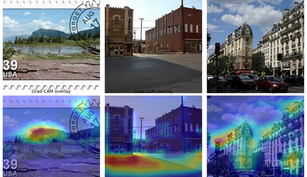
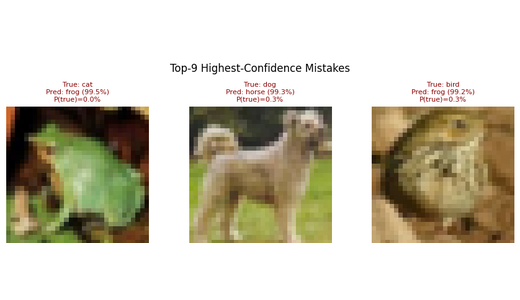
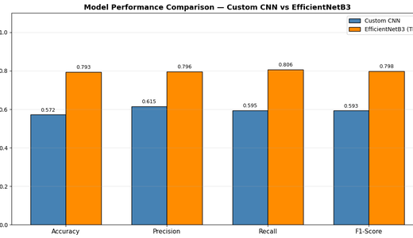
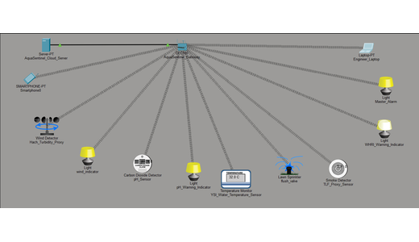
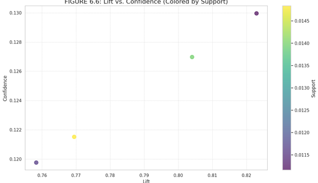

**Third-year Computer Science student @ Taylor's University, Malaysia** 
BSc (Hons) Computer Science · AI specialization · Data Science extension · UWE Bristol dual award

---

## 🧑‍💻 About me

I'm a third-year Computer Science student specialising in **AI**, with an extension in **Data Science**. I like taking models apart: I measure a problem before designing around it, read per-class errors instead of stopping at accuracy, and write down the experiments that didn't go my way.

I'm still early in my journey, and there's a lot I haven't built yet, especially deployed systems and LLM applications. That's what I'm working on next. I'm looking for an **AI/ML or data internship (April–July 2027; Qatar, Malaysia or remote)** where I can learn from people who ship real products.

- 🔭 **Now:** Speech ML Engineer on my final-year team project, *Verbatim*, designing an overlap-aware transcription pipeline for noisy multi-speaker audio (design stage, no results yet)
- 🌱 **Learning:** model calibration, retrieval-augmented generation (RAG) with proper evaluation, deploying models behind an API
- 🎯 **Interested in:** AI/ML engineering → data science and analysis → data engineering
- 🗣️ **Languages:** Arabic and English

## 🧪 Featured projects

<table>
<tr>
<td width="50%" valign="top">

<h3><a href="https://github.com/Mazen-devs/resscene-cnn-gradcam">ResScene-CNN v2</a></h3>
Squeeze-and-excitation residual CNN for 6-class scene recognition, with <b>Grad-CAM written from scratch</b>. <b>84.47%</b> test accuracy with 1.31M params; beats a fine-tuned EfficientNetB0 on glacier recall with 3.1× fewer parameters. Grad-CAM uncovered a postage stamp hiding in the test set.  
   
</td>
<td width="50%" valign="top">

<h3><a href="https://github.com/Mazen-devs/cifar-inception-from-scratch">CIFARInception</a></h3>
Inception-style CNN in <b>PyTorch</b> for native 32×32 images: <b>84.23%</b> on CIFAR-10 with 0.55M params (≈0.4% of VGG-16), trained in 10.4 min. Starts with a vanishing-gradient experiment and ends with an ablation it didn't win.  
  
</td>
</tr>
<tr>
<td width="50%" valign="top">

<h3><a href="https://github.com/Mazen-devs/realwaste-transfer-learning">RealWaste</a></h3>
Custom CNN vs <b>EfficientNetB3</b> transfer learning on 4,752 real landfill photos in 9 imbalanced classes. Two-phase fine-tuning lifts accuracy <b>57.22% → 79.35%</b> (+22.13 pts), with an honest note on what my evaluation got wrong.  
  
</td>
<td width="50%" valign="top">

<h3><a href="https://github.com/Mazen-devs/aquasentinel-iot-water-quality">AquaSentinel Predictive</a></h3>
IoT water-quality early-warning system: an edge-to-cloud design with four algorithms, plus a <b>13-device simulation</b> with Python-scripted sensors and 10 automation rules. <b>7/7 tests passed</b>, with alerts in 3–4 s.  
  
</td>
</tr>
<tr>
<td width="50%" valign="top">

<h3><a href="https://github.com/Mazen-devs/grocery-market-basket-analysis">Grocery Market-Basket Analysis</a></h3>
Apriori on <b>38,765</b> purchases (14,963 baskets). The headline rule "rolls/buns → whole milk" has <b>lift 0.80</b>, so it isn't really a rule, just milk's popularity. A lesson in reading lift, not confidence.  
  
</td>
<td width="50%" valign="top">
<h3>🛠️ Coming next</h3>
<ul>
<li>Calibration follow-up: temperature scaling and a reliability diagram for CIFARInception</li>
<li>A deployed demo of one of my CNNs behind an API</li>
<li>A RAG project with a real evaluation set</li>
<li>The first speech baseline for <i>Verbatim</i></li>
</ul>
Planned work. Each item gets a repo only once it exists.
</td>
</tr>
</table>

## 🛠️ Tech stack

**Languages** 

**Deep learning & computer vision** 

**Machine learning & data** 

**Visualization & big data** 

**Tools & platforms** 

## 🎓 Education

**Taylor's University, Malaysia** · *Bachelor of Computer Science (Honours)* · Sep 2024 – Aug 2027 (expected) 
AI specialization · Data Science extension · dual award with UWE Bristol

| | |
|---|---|
| **CGPA** | 3.43 / 4.00 |
| **Honours** | Dean's List ×3 (Feb–Mar 2025, Sep 2025–Jan 2026, Apr–Jul 2026) |
| **Top modules** | Computer Vision & NLP **(A)** · Deep Learning **(A-)** · Data Mining **(A-)** · Big Data Technologies **(A-)** · Systems Analysis & Design **(A)** |
| **Also studied** | Machine Learning & Intelligent Systems · Statistical Inference & Modeling · Data Visualization · Data Science Principles · Internet of Things |

## 📜 Certifications

 
 

## 🧭 How I work

| Principle | Where you can see it |
|---|---|
| **Measure before designing** | CIFARInception opens with a gradient-flow experiment (8.84 × 10⁻⁷ vs 5.5) before choosing an architecture |
| **Read the errors, not just the accuracy** | Per-class recall, the top confusion pairs and the most confident mistakes in every vision repo |
| **Report what didn't work** | An ablation I lost, a hold-out set I misused, rules with lift below 1: all documented |
| **Separate designed from built** | AquaSentinel's ML models and *Verbatim* are labelled as designs until they have results |
| **Make it checkable** | Executed notebooks, source code and tests, so every number can be verified |

## 📫 Get in touch

Recruiting for an **AI/ML, computer vision or data internship** (April–July 2027)? I'd love to hear about it. Open an [issue on this repo](https://github.com/Mazen-devs/Mazen-devs/issues) or reach me through the contact details on my resume.

All projects are university coursework (Taylor's University, 2025–2026), published with code, figures and executed notebooks so every number can be checked.

